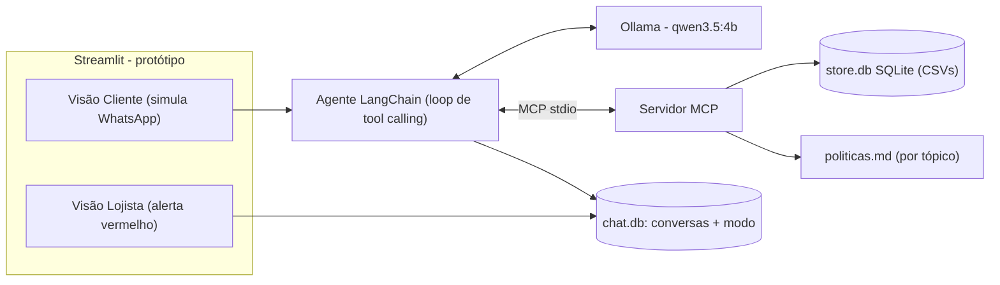

# 🎸 Empório da Música - Agente de Atendimento (protótipo)

Agente de atendimento por mensagens de texto para a **Empório da Música** (loja fictícia de instrumentos, Campo Grande/MS), construído para o Desafio Técnico de AI Engineer da Artefact.

O agente roda **100% local** (Ollama), consulta os dados da loja por um **servidor MCP** e aplica as políticas do manual. Quando não sabe ou não pode resolver, **avisa o lojista com um alerta vermelho** e para de responder até um humano assumir. Por padrão, ele atende sozinho.

> ⚠️ **É um protótipo.** A interface (Streamlit) simula um WhatsApp para demonstração. Não há integração com o WhatsApp real (veja [Limitações](#limitações-conhecidas-e-próximos-passos)).

## Sumário
1. [Como funciona](#como-funciona)
2. [Como rodar](#como-rodar)
3. [Decisões técnicas e justificativas](#decisões-técnicas-e-justificativas)
4. [Exemplos de interação](#exemplos-de-interação)
5. [Limitações conhecidas e próximos passos](#limitações-conhecidas-e-próximos-passos)
6. [Uso de assistentes de código](#uso-de-assistentes-de-código)
7. [Estrutura do repositório](#estrutura-do-repositório)

## Como funciona



**Ferramentas expostas pelo servidor MCP** ([`app/mcp_server/server.py`](app/mcp_server/server.py)):

| Ferramenta | Quando o agente usa |
|---|---|
| `search_products` | "violões até R$ 1000", "tem promoção?" (filtros de preço, disponibilidade e promoção) |
| `get_product_details` | Um modelo específico ("Takamine GD20"): preço, promoção, PIX, parcelamento, specs, alternativas se indisponível |
| `list_categories` | O que a loja vende |
| `get_customer_orders` | Status, rastreio, entrega e prazos de troca/devolução **do cliente da conversa** |
| `get_store_policies` | Regras: endereço, pagamento, troca, frete, garantia, promoções, LGPD |
| `get_opening_status` | "Estão abertos agora?" |

Além disso o agente tem uma ferramenta **local** (fora do MCP, pois escreve no estado da conversa): `request_human_handoff(reason)`.

**Fluxo do lojista:** `agent` (padrão) → o agente chama `request_human_handoff` → `waiting_human` (🔴 alerta vermelho no topo do painel com o motivo, agente em silêncio) → lojista clica em **Assumir** → `human` (🟡, responde pela UI) → **Devolver ao agente** → `agent`.

## Como rodar

### Pré-requisitos
- Python 3.10+ (testado com 3.12)
- [Ollama](https://ollama.com) instalado e rodando
- ~4 GB de RAM livres para o modelo padrão

### Passo a passo
```bash
# 1. modelo (padrão: qwen3.5:4b; o 9b também funciona, veja a nota de desempenho)
ollama pull qwen3.5:4b

# 2. ambiente
python -m venv .venv
.venv\Scripts\activate            # Windows   (Linux/macOS: source .venv/bin/activate)
pip install -r requirements.txt
copy .env.example .env            # Linux/macOS: cp .env.example .env   (opcional)

# 3. interface (WhatsApp simulado + painel do lojista)
streamlit run app/ui/streamlit_app.py
```
O banco `storage_data/store.db` é criado automaticamente a partir dos CSVs em `data/` na primeira execução (ou manualmente: `python -m app.ingest`).

### Outros comandos
| Comando | O que faz |
|---|---|
| `python -m app.cli --customer 1 --fresh` | Conversa pelo terminal como o cliente 1 |
| `python -m pytest` | 16 testes determinísticos da camada de dados e regras de negócio (sem LLM) |
| `python -m evals.run_scenarios` | Avalia 5 cenários contra o Ollama, verificando se a ferramenta esperada foi chamada |
| `python -m evals.run_scenarios --export` | Idem e regrava `examples/*.md` |

### Configuração (`.env`)
| Variável | Padrão | Descrição |
|---|---|---|
| `OLLAMA_MODEL` | `qwen3.5:4b` | Modelo Ollama com suporte a *tool calling* |
| `OLLAMA_BASE_URL` | `http://localhost:11434` | Endereço do Ollama |
| `FAKE_NOW` | (vazio) | Fixa a "data de hoje" (ex.: `2026-03-20T10:00:00`) para demonstrar prazos de devolução e horário de funcionamento de forma reprodutível |

### Como usar a demo
1. Na barra lateral, escolha **📱 Cliente** e um contato; converse como se fosse o cliente.
2. Peça algo que exija a equipe (ex.: *"Quero devolver meu pedido"* → *"Sim, quero devolver"*).
3. Troque para **🏪 Lojista**: o alerta vermelho aparece no topo e o contato fica com 🔴 na lista. Clique em **Assumir conversa**, responda como atendente e depois **Devolver ao agente**.

## Decisões técnicas e justificativas

| Tema | Decisão | Justificativa |
|---|---|---|
| **Framework do agente** | **LangChain** (`create_agent`, `langchain-ollama`, `langchain-mcp-adapters`) | Robusto, amplamente adotado e 100% gratuito/open source. Já traz o loop de *tool calling*, integração nativa com Ollama e com MCP. Caminho natural para LangGraph (fluxos com estado) se o agente crescer. |
| **Um agente ou vários? (A2A)** | **Agente único** + MCP | O escopo cabe em ~7 ferramentas. Com um modelo local pequeno, cada salto entre agentes soma latência e chance de erro. **A2A é a evolução recomendada** caso surjam responsabilidades separadas (ex.: agente de pós-venda/logística, agente de vendas consultivas, agente de cobrança), cada um com suas ferramentas. |
| **Acesso a dados** | **Servidor MCP** (SDK oficial, FastMCP, transporte stdio) | Desacopla dados/regras do agente: o mesmo servidor pode ser reaproveitado por outro cliente (WhatsApp real, outro LLM, Claude Desktop). O agente mantém a sessão MCP viva em um event loop em background para não pagar o custo de subir o processo a cada mensagem. |
| **LLM / provedor** | **Ollama local, `qwen3.5:4b`** (padrão), `qwen3.5:9b` configurável | Custo zero, sem enviar dados de clientes a terceiros (LGPD) e roda em máquina comum. Ver nota de desempenho abaixo. `reasoning=False` (modo *thinking* desligado) para reduzir latência: roteamento de ferramentas não precisou dele nos testes. |
| **Retrieval de políticas** | **Sem banco vetorial**: PDF curado em [`politicas.md`](app/knowledge/politicas.md), dividido em 9 tópicos; `get_store_policies(topic)` com `enum` de tópicos | O manual tem ~4 mil tokens e é bem estruturado. Seleção por tópico é exata, determinística e auditável. Embeddings trariam risco de recuperar o trecho errado e mais dependências sem ganho aqui. Escala? Veja limitações. |
| **Retrieval de dados** | CSV → **SQLite** + consultas parametrizadas | Filtros exatos (preço ≤ X, em estoque, promoção ativa) são SQL/Python, não "adivinhação" do LLM. Busca textual tolera acentos e plural (`violões` = `violao`). |
| **Regras no código, não no prompt** | Preço final com promoção, PIX (5%, **não cumulativo** com promoção), parcelamento máximo pela política, prazos de arrependimento/defeito/garantia, loja aberta/fechada | Um modelo pequeno **lê** resultados prontos em vez de calcular. Evita erro numérico e "propaganda enganosa" (manual §7.1). As ferramentas devolvem textos já formatados (`R$ 2.199,00`). |
| **Estratégia de prompt** | [`prompts.py`](app/agent/prompts.py): persona "Léo" (tom do manual: *amigo que entende de música*), **regra nº 1: responder sempre em português**, tabela "pergunta → ferramenta", regras de negócio, escopo, quando chamar humano, poucos exemplos. Contexto dinâmico: nome do cliente e data/hora atuais | Modelos pequenos seguem melhor instruções curtas, imperativas e com mapeamento explícito de ferramentas. Ferramentas ficam com nomes em inglês (o modelo as chama melhor), mas o agente é instruído a responder **apenas em português**. |
| **Segurança/privacidade** | `customer_id` das consultas de pedidos é **sobrescrito pela aplicação** (interceptor MCP), nunca vem do LLM | Mesmo com prompt injection, um cliente só enxerga os próprios pedidos (LGPD). |
| **Escalonamento humano** | Ferramenta `request_human_handoff` + modo da conversa persistido (`agent` / `waiting_human` / `human`) | Atende ao requisito: agente autônomo por padrão, alerta vermelho para o lojista, agente em silêncio até ser devolvido. |
| **Guard rails** | (1) Se o texto promete acionar a equipe e a ferramenta não foi chamada, o handoff é registrado automaticamente (`request_human_handoff(auto)`); (2) qualquer exceção/resposta vazia/timeout vira handoff com mensagem padrão ao cliente | Bug real encontrado nos testes: o modelo disse "vou avisar a equipe" sem chamar a ferramenta. O cliente nunca fica sem resposta nem sem dono. |
| **Persistência** | SQLite (`chat.db`): conversas por cliente, mensagens, ferramentas usadas, modo | Sem servidor, histórico sobrevive a reinícios; o histórico recente (20 msgs) é enviado ao modelo. |
| **Interface** | **Streamlit**, uma tela com duas visões (Cliente / Lojista); contatos vêm de `customers.csv` | Foco do desafio é o agente, não o front. É deliberadamente um **protótipo** (veja evoluções com FastAPI). Negrito em formato WhatsApp (`*texto*`) é normalizado e exibido corretamente. |

### Nota de desempenho (decisão baseada em medição)
Medido na máquina de desenvolvimento (GTX 1650 4 GB, i7-4790, 16 GB RAM):

| Modelo | Geração | Resposta típica de ponta a ponta |
|---|---|---|
| `qwen3.5:9b` | ~4 tokens/s (boa parte na CPU) | **~3,5 min** (inviável para atendimento) |
| `qwen3.5:4b` | ~8 tokens/s | **~30-55 s** (a 1ª mensagem inclui o carregamento do modelo) |

Por isso o padrão é o 4b. Em hardware melhor basta `OLLAMA_MODEL=qwen3.5:9b` (ou maior) no `.env`. Ainda assim, ~30 s é lento para WhatsApp real; em produção usaria GPU dedicada ou um modelo hospedado (veja próximos passos).

## Exemplos de interação

Execuções reais do agente, geradas por `python -m evals.run_scenarios --export` (incluem as ferramentas chamadas):

| # | Cenário | Destaque |
|---|---|---|
| [01](examples/01_catalogo.md) | Violões até R$ 1000 + detalhes de um modelo | Consulta de catálogo com filtro de preço |
| [02](examples/02_loja.md) | Endereço e "estão abertos agora?" | Política vs. status em tempo real |
| [03](examples/03_preco_promocao.md) | Preço do Takamine GD20 e promoções ativas | Preço de tabela, PIX, parcelamento, promoção ativa (sem acumular com PIX) |
| [04](examples/04_devolucao.md) | "Me arrependi da compra" | **Não trivial:** pedido do cliente + prazo de 7 dias + handoff humano com alerta |
| [05](examples/05_fora_escopo.md) | Receita de bolo e corda de violão | Fora de escopo e produto que a loja não vende |

## Limitações conhecidas e próximos passos

**Limitações**
- **Sem WhatsApp real**: a UI é uma simulação. Em produção seria um webhook (WhatsApp Business Cloud API) → o mesmo `handle_customer_message`.
- **Latência alta** (dezenas de segundos) por rodar um LLM em hardware modesto; sem *streaming* de resposta nem indicador de "digitando" real.
- **Qualidade do modelo pequeno**: pode errar roteamento ou omitir informações (ex.: citar menos produtos do que retornou). Mitigado com regras no código, guard rails e avaliação por cenário, mas não eliminado. Os testes de cenário são poucos (5) e não medem qualidade textual.
- **Data de recebimento aproximada**: os dados só trazem a *previsão* de entrega; ela é usada como proxy dos prazos de devolução/garantia (o agente é instruído a não prometer sem confirmar com a equipe). Feriados não são considerados no horário de funcionamento.
- **Recuperação de políticas por tópico**: ótimo para um manual curto, mas não escala para centenas de páginas (aí valeria busca híbrida/embeddings).
- **Painel do lojista com atualização manual** (botão 🔄) e sem autenticação; um único processo.
- **Políticas curadas manualmente** a partir do PDF (a extração automática quebra tabelas). Mudou o manual → atualizar `politicas.md`.
- Dados do manual com dois números: telefone fixo **(67) 3341-4444** (só ligações) e WhatsApp **(67) 3321-4500** (só mensagens); o agente os trata assim.

**Com mais tempo**
- **FastAPI + front real** (WebSocket, atualização em tempo real do painel, múltiplos lojistas, autenticação) no lugar do Streamlit, e webhook do WhatsApp Business.
- **A2A** com agentes especialistas (vendas, pós-venda/logística, cobrança) quando houver necessidade de mais de um agente.
- **LangGraph** para fluxos com estado explícito (ex.: coleta guiada de dados para devolução) e confirmação antes de ações.
- Ferramentas de **escrita** (abrir chamado de devolução, reservar produto) com confirmação humana.
- Avaliação mais robusta (LLM-as-judge, conjunto maior de perguntas adversariais/prompt injection), observabilidade (LangSmith/Langfuse) e testes de carga.
- Modelo hospedado/GPU dedicada ou *speculative decoding* para latência < 5 s; cache de respostas a perguntas frequentes (horário, endereço).
- Fila de atendimento com SLA (manual: retorno em até 24 h úteis para reclamações) e notificação ao lojista (WhatsApp/e-mail/push).

## Uso de assistentes de código

Usei o **Antigravity** (agente de código do Google DeepMind) como par de programação, com o seguinte workflow:

1. **Eu defini o problema e as decisões de arquitetura** (Ollama local, MCP para dados, A2A só se necessário, UI estilo WhatsApp com cadastro de clientes, alerta vermelho para o lojista, agente autônomo por padrão).
2. **O assistente explorou os dados** (CSVs e PDF) e propôs um **plano** (`implementation_plan`), apontando armadilhas: só 4 de 25 promoções ativas, PIX não cumulativo com promoção, loja não vende acessórios, todos os pedidos já fora do prazo de arrependimento, contradição aparente de telefones.
3. **Eu revisei o plano e tomei as decisões**: LangChain (com `pydantic-ai` como plano B se houvesse custo), Streamlit como protótipo com FastAPI como evolução, ferramentas em inglês mas respostas em português, versionar `data/`, esclarecer a diferença telefone/WhatsApp.
4. **O assistente implementou em etapas pequenas, com commits incrementais**, escrevendo testes determinísticos para as regras de negócio antes de ligar o LLM.
5. **Medimos e ajustamos com dados reais**: o `qwen3.5:9b` levou ~3,5 min por resposta na minha máquina; comparamos com o 4b e **eu escolhi** trocar o padrão. Rodar os cenários revelou dois problemas (o agente prometer acionar a equipe sem chamar a ferramenta e citar "loja parceira" inexistente), corrigidos com guard rail no código e ajuste de prompt.

As decisões de arquitetura e produto acima foram minhas; o assistente acelerou a implementação, os testes e as medições.

## Estrutura do repositório

```
app/
  agent/            agent.py (LangChain + MCP + Ollama), prompts.py
  mcp_server/       server.py (ferramentas MCP)
  knowledge/        politicas.md (manual por tópico)
  storage/          chat_store.py (conversas, modo agente/humano)
  ui/               streamlit_app.py (WhatsApp simulado + painel do lojista)
  repository.py     acesso a dados + regras de negócio determinísticas
  ingest.py         CSV -> SQLite
  config.py, cli.py
data/               CSVs e PDF do desafio
tests/              testes das regras de negócio (sem LLM)
evals/              cenários + exportação dos exemplos
examples/           conversas reais do agente
```
